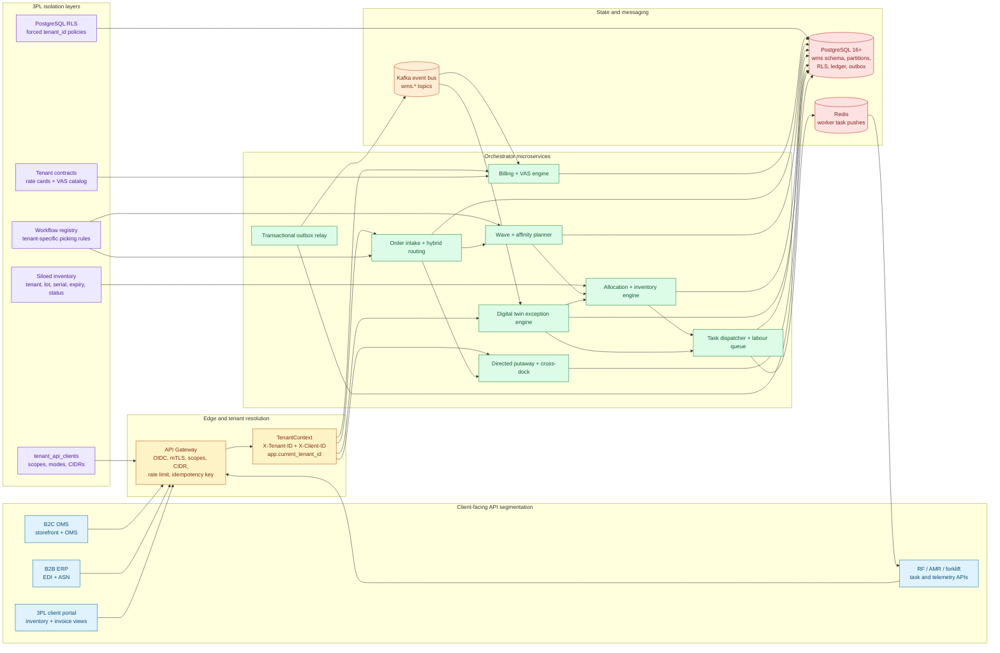
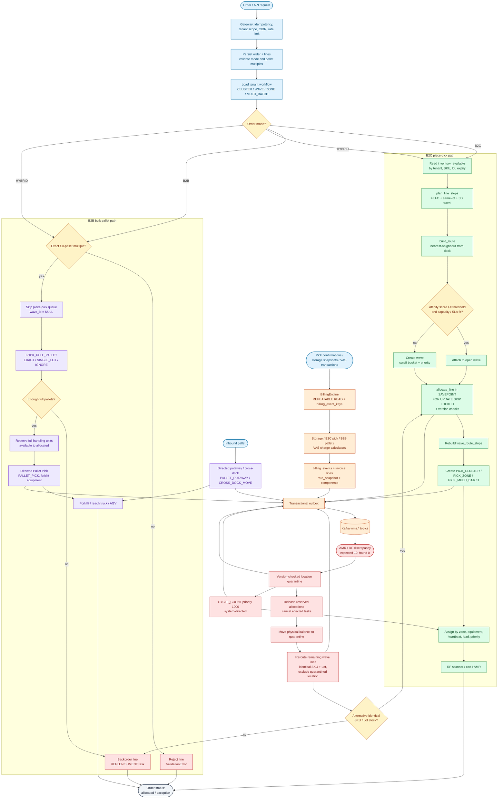

# Hybrid / 3PL Warehouse Management System — Master Architecture Specification

**Design baseline:** 2026-11-10  
**Target platform:** PostgreSQL 16+, Python 3.13, FastAPI, Pydantic v2, psycopg 3, Redis 7+, Kafka 3+, React/RF/AMR/forklift clients  
**Role baseline:** Principal Software Architect and Lead Supply Chain Systems Engineer  
**Scope:** one shared 3PL warehouse estate serving concurrent B2C piece picking, B2B pallet operations, and tenant-isolated client-facing APIs.

## 1. System intent and operating envelope

The system is a single transactional orchestrator over a tenant-isolated PostgreSQL estate. It does not separate B2C and B2B into disconnected stacks: both modes share the same tenant context, SKU/lot/location master data, inventory ledger, task queue, outbox, and billing contracts. Mode-specific behaviour is selected by workflow configuration and by the `order_lines.mode` value.

| Mode | Unit of work | Primary path | Queue | Equipment |
|---|---|---|---|---|
| B2C | each / carton | affinity wave or cluster, zone, multi-batch | `PICK_PIECE`, `PICK_CLUSTER`, `PICK_ZONE`, `PICK_MULTI_BATCH` | RF scanner, cart, AMR |
| B2B | full pallet | directed pallet pick, cross-dock, bulk staging | `PALLET_PICK`, `PALLET_PUTAWAY`, `CROSS_DOCK_MOVE` | forklift, reach truck, AGV |
| HYBRID | both | one order with B2C and B2B lines; independent paths | both queues above | both equipment sets |
| 3PL | tenant-scoped | RLS isolation, tenant workflow, tenant contract, client API segmentation | all queues, tenant-tagged | all equipment sets |

Design targets:

- No double allocation and no phantom stock under concurrent pickers: row locks, `SKIP LOCKED`, optimistic version predicates, status-keyed balances, double-entry ledger rows, and per-line savepoints.
- Deterministic exception handling: identical inputs and committed state produce the same quarantine, reallocation, task, and event identifiers.
- Tenant isolation is enforced in the database, not only in application code: forced RLS, tenant-scoped compound keys, `app.current_tenant_id`, API-client scopes/modes/CIDRs, and tenant-specific workflow/contract records.
- Every state mutation that leaves the service boundary is written through the transactional outbox.
- Billing is reproducible: each charge stores its rate-card snapshot, component breakdown, currency exponent, rounding mode, and idempotency key.

## 2. System architecture



The API Gateway is the only ingress. It resolves OIDC/mTLS identity, validates tenant/client headers, enforces scopes, CIDR allowlists, rate limits, and idempotency keys. `TenantContext` is injected into every request and the database transaction calls `set_config('app.current_tenant_id', ..., true)`. The `wms_app` role is subject to forced RLS; the `wms_migration` role is BYPASSRLS and is used only for DDL and the outbox relay.

The orchestrator is deliberately modular: pure functions in `affinity.py` and `pricing.py` are side-effect free and unit testable; repositories own SQL; `RoutingService`, `DigitalTwinExceptionEngine`, `BillingEngine`, and `TaskDispatcher` own use-case transactions. Redis carries ephemeral task pushes only. Kafka carries committed domain events only. PostgreSQL is the authoritative system of record.

## 3. Hybrid order fulfillment workflow



B2B orders never enter a wave, `wave_orders`, `wave_order_lines`, or a piece-pick task. They use `LOCK_FULL_PALLET`, reserve whole handling units, and create `PALLET_PICK` tasks with forklift-class equipment. B2C orders use `inventory_available`, lot-aware stop planning, nearest-neighbour routes, affinity scoring, wave attachment/creation, and version-checked allocation. HYBRID orders execute both branches inside one idempotent transaction.

The discrepancy branch is a deterministic state machine, not a best-effort compensator. It quarantines the coordinate, releases reserved allocations, moves physical balances to `quarantine`, reroutes remaining wave lines to identical SKU/lot stock, and emits a priority-1000 `CYCLE_COUNT` task.

## 4. Multi-tenant and hybrid inventory storage engine

### 4.1 Isolation layers

1. **Gateway segmentation.** `tenant_api_clients` stores `scopes`, `allowed_modes`, `allowed_cidrs`, `rate_limit_rps`, status, and revocation. `catalog.validate_api_client` re-checks gateway scopes against the database registration on every write.
2. **Transaction context.** `Database.tenant_transaction` sets `statement_timeout` and `app.current_tenant_id` with transaction-local `set_config`. All composite primary keys begin with `tenant_id`.
3. **Database RLS.** `apply_tenant_rls` creates `p_tenant_isolation` on every tenant-owned table and partition: `USING (tenant_id = app_current_tenant_id()) WITH CHECK (tenant_id = app_current_tenant_id())`. `ALTER TABLE ... FORCE ROW LEVEL SECURITY` prevents table owners from bypassing policy.
4. **Shared physical estate.** Warehouses and locations are shared infrastructure. `tenant_warehouse_access` grants read/write/bill rights. `locations.exclusive_tenant_id` optionally reserves a slot for one tenant. `p_locations_access` allows shared locations only when the tenant has warehouse access, and only permits writes with `can_write`.
5. **Siloed inventory.** `inventory_bucket_headers` and `inventory_balances` are tenant-owned. A natural bucket is `(tenant_id, sku_id, warehouse_id, location_id, lot_id, serial_number, expiration_date, handling_unit_id)` with `UNIQUE NULLS NOT DISTINCT`, so null lots are still unique.
6. **Custom workflows.** `workflow_definitions` is versioned per tenant and merged over `DEFAULT_WORKFLOW`; active versions are unique per `(tenant_id, workflow_key)`.
7. **Tenant contracts.** `tenant_contracts`, `contract_storage_rates`, `contract_pick_rates`, and `vas_rate_cards` are tenant-owned and date-effective.

### 4.2 Required master tables

| Table | Required data | Key constraints and indexes |
|---|---|---|
| `tenants` | code, legal name, status, currency, timezone, data region, isolation tier, billing cutoff | unique code, status enum, currency/timezone checks |
| `skus` | tenant, code, dimensions, generated `unit_volume_cm3`, `unit_weight_kg`, carton/pallet geometry, hazardous flag/class, temperature band, velocity class/score/picks/units, lot/serial requirements, shelf life, status | composite PK `(tenant_id,id)`, unique `(tenant_id,sku_code)`, slotting and hazmat compound indexes |
| `lots` | tenant, SKU, lot code, manufactured/expiry dates, attributes, FEFO index | composite FKs, unique `(tenant_id,sku_id,lot_code)`, `ix_lots_fefo` |
| `locations` | `warehouse_id, zone, aisle, bay, level, position`, barcode, 3D `x_m,y_m,z_m`, `travel_seq`, `max_volume_cm3`, `max_weight_kg`, `current_volume_cm3`, `current_weight_kg`, generated available capacity, `status`, pick-face, mixed SKU/lot/tenant flags, hazmat, temperature, slot class, quarantine reason/time, version | unique coordinate, unique barcode, capacity checks, quarantine invariant, routing/capacity/tenant/quarantine compound indexes |
| `handling_units` | tenant, barcode, HU type, status, warehouse, location, SKU, lot, quantity, full-pallet quantity, volume/tare, attributes, version | unique tenant barcode, full-pallet check, partial index `ix_handling_units_full_pallet` |
| `inventory_bucket_headers` | tenant, SKU, warehouse, 3D location, lot, serial, expiry, HU, version | natural unique key with `UNIQUE NULLS NOT DISTINCT`, composite FKs to SKU/lot/location/HU |
| `inventory_balances` | tenant, bucket, `stock_status`, quantity, version | unique `(tenant_id,bucket_id,stock_status)`; `ix_balances_available` partial index for positive available quantity; `ix_balances_nonconsumed` partial index for physical statuses |
| `inventory_ledger` | double-entry deltas from/to status, balance-after, reason, reference, actor, correlation, metadata | append-only, tenant RLS, monthly partitions |

`stock_status` contains `available`, `allocated`, `damaged`, `qc_hold`, `quarantine`, `in_transit`, and `consumed`. `location_status` contains `active`, `quarantine`, `blocked`, `maintenance`, and `disabled`. The `inventory_available` view is `security_invoker=true, security_barrier=true` and exposes only `available`, positive, active-location, active-SKU balances to the routing service.

### 4.3 Explicit concurrency contract

The DDL comment `CONCURRENCY CONTRACT — enforced by services/orchestrator/allocation.py` is implemented as follows:

1. `LOCK_ALLOCATION_CANDIDATE` uses a CTE to select one lot whose summed available quantity satisfies the remaining line quantity when `lot_filter_mode = SINGLE_LOT`. The locking CTE then uses `FOR UPDATE OF h, b, l SKIP LOCKED` and `LIMIT 1`.
2. `UPDATE_AVAILABLE_BALANCE`, `BUMP_HEADER_VERSION`, and `UPDATE_ORDER_LINE_ALLOCATED` all require the previously read `version` and a quantity guard. A stale writer affects zero rows and never silently over-allocates.
3. `UPSERT_ALLOCATED_BALANCE` atomically increments the `allocated` status row for the same bucket.
4. `AllocationRepository.allocate_line` wraps the whole line in `async with conn.transaction()`, a PostgreSQL SAVEPOINT. A shortage, version conflict, or retry exhaustion rolls back every partial balance move, allocation row, order-line version, ledger row, and outbox event for that line.
5. `B2BRepository.reserve_full_pallets` uses the same savepoint pattern for full-pallet reservations.
6. `TASK_QUEUE_CLAIM` and `TASK_CLAIM_FOR_WORKER` use `FOR UPDATE SKIP LOCKED`; `FIND_ELIGIBLE_WORKER` uses `FOR UPDATE OF w SKIP LOCKED`.
7. Quarantine uses `LOCK_LOCATION_FOR_QUARANTINE ... FOR UPDATE` followed by a version-checked `UPDATE_LOCATION_QUARANTINE`.
8. Billing uses `REPEATABLE READ` plus `billing_event_keys` unique idempotency.
9. All domain events are inserted into `event_outbox` in the same transaction as the state change; `OutboxRelay` publishes committed rows with `SKIP LOCKED` and idempotent Kafka headers.

## 5. Hybrid picking and labour orchestration

### 5.1 3D travel model

For coordinates `a=(x,y,z,zone)` and `b=(x,y,z,zone)`:

```text
travel_m(a,b) = |ax-bx| + |ay-by| + vertical_penalty * |az-bz|
                + (zone_penalty_m when zones differ, else 0)
```

Default `vertical_penalty = 3`, `zone_penalty_m = 25`. `location_travel_cost` in SQL uses the same deterministic cost function for candidate ordering. `build_route` uses nearest-neighbour sequencing from the outbound dock and adds the return-to-dock leg.

### 5.2 Lot-aware stop planning

`plan_line_stops` enforces SKU, exact lot, serial, expiry, hazardous, temperature, and location-type compatibility. When no lot is specified but `require_same_lot=true`, it groups candidates by lot, discards groups whose summed available quantity cannot satisfy `LineRequirement.remaining_qty`, and selects the group with the best FEFO/dock-travel/pick-face key. This prevents a wave plan from locking onto a short lot. Explicit `lot_id` always constrains candidates, including when `require_same_lot` is false.

### 5.3 Wave affinity algorithm

`compute_affinity` computes Jaccard similarity over location, SKU, and zone signatures, incremental travel after merging routes, and SLA/cutoff compatibility:

```text
score = 0.42 * Jaccard(locations)
      + 0.18 * Jaccard(SKUs)
      + 0.15 * Jaccard(zones)
      + 0.20 * clamp(1 - incremental_travel_m / 900, 0, 1)
      + 0.05 * sla_compatibility(...)
```

`choose_wave` filters open `planned`/`released` waves by warehouse, strategy, release horizon, order/line/unit capacity, carrier/cutoff bucket, zone count, and merged travel. It rejects scores below `0.62` and chooses the deterministic key `(-score, incremental_travel_m, wave_id)`. If no wave qualifies, `wave_repo.create_wave` creates one with a priority, cutoff bucket, capacity, and initial route. `ZONE` strategy creates one wave per zone; `WAVE`, `CLUSTER`, and `MULTI_BATCH` create one wave for the order. `wave_route_stops` stores the rebuilt deterministic route.

### 5.4 Allocation and task creation

For each B2C line, `AllocationRepository.allocate_line` locks one candidate at a time, moves quantity from `available` to `allocated`, inserts `inventory_allocations`, updates `order_lines.allocated_qty`, writes two `inventory_ledger` rows, and emits `inventory.allocated`. Task payloads contain ordered stops, allocation IDs, dock coordinates, and correlation ID. Tasks are chunked by `b2c.max_lines_per_task = 40` and priority is derived from order priority, SLA urgency, and strategy.

For each B2B line, `order_repo.create_order` already rejects non-pallet units and non-multiples of `units_per_pallet`. `LOCK_FULL_PALLET` locks `PALLET` handling units with `is_full`, `status='available'`, `qty = skus.units_per_pallet`, an available balance covering the HU quantity, active compatible location, and `EXACT`, `SINGLE_LOT`, `IGNORE`, or `NULL` lot mode. It prefers cross-dock, then staging, then pallet/bulk, then dock travel. Reservations update HU status to `allocated`, version-check the balance/header/order line, write ledger rows, and emit `pallet.reserved`. Missing pallets roll back partial reservations, mark the line `backordered`, and create a high-priority `REPLENISHMENT` task. Successful reservations create `PALLET_PICK` tasks with forklift-class equipment and `wave_id = NULL`.

### 5.5 Directed putaway and cross-dock

`plan_directed_putaway` resolves SKU, lot, source location, and dock; computes required volume/weight; calls `FIND_PUTAWAY_LOCATION`, which uses `location_slot_compatibility` to reject mixed SKU/tenant/lot violations; creates an `in_transit` HU, bucket, balance, and ledger row; and enqueues `PALLET_PUTAWAY` or `CROSS_DOCK_MOVE`. `complete_pallet_move` locks the task, HU, and target location, verifies count/capacity/compatibility, moves the HU and bucket to the target, converts `in_transit` to `available`, writes ledger rows, completes the task/assignment, and emits `inbound.pallet.putaway_completed`.

### 5.6 Worker priority queue

`FIND_ELIGIBLE_WORKER` filters by tenant, warehouse, operational status (`available` or `working`), heartbeat TTL, active equipment, zone permission, and active task load. Its score is:

```text
score = task_priority * 10
      + 200 when current_zone matches required_zone
      + 150 when active_equipment is in required_equipment
      + 80 when status = available
      - min(active_tasks, 10) * 20
      - |worker_x - dock_x| - |worker_y - dock_y|
```

Claims are locked with `FOR UPDATE OF w SKIP LOCKED`; assignments are version-checked; Redis publishes to `wms.tasks.{tenant_id}.{worker_id}`. Worker claim endpoints re-check heartbeat, equipment, zone permission, and `max_concurrent_tasks`.

## 6. Real-time digital twin and spatial exception handling

`POST /v1/events/inventory-discrepancy` is idempotent on `(tenant_id, source, source_event_id)` and on the idempotency key. The engine executes these steps atomically:

1. Validate API client, resolve location with tenant-aware warehouse access, resolve SKU and lot, and insert `inventory_discrepancy_events` with status `processing`.
2. Lock the location and set `status='quarantine'`, `quarantine_reason`, `quarantined_at`, and increment `version`.
3. `RELEASE_ALLOCATIONS_AT_LOCATION` locks reserved allocations at that location for the supplied wave or unassigned B2B allocations. Each released allocation is marked `released_discrepancy`, `order_lines.allocated_qty` is decremented under version control, and pick/pallet tasks referencing the allocation or line are cancelled.
4. `LOCK_DISCREPANCY_BUCKETS` locks positive `available`, `allocated`, `damaged`, and `qc_hold` balances for the SKU/lot at the coordinate. Each balance is moved to `quarantine`, with double ledger rows.
5. `GET_WAVE_UNFULFILLED_LINES` selects wave lines where `required_qty > picked_qty + allocated_qty`, plus any released lines outside the wave. Preferred alternative locations come from the surviving wave route.
6. For each unfulfilled line, the engine sets the reported lot as an exact lot constraint, requires the same lot, excludes the quarantined coordinate, and calls `allocate_line`. Successful reallocations create replacement pick tasks with the original wave linkage and correlation ID. Shortages mark the line `backordered`, create `REPLENISHMENT`, and record the reason.
7. `wave_repo.rebuild_wave_route` removes stops at the quarantined coordinate and merges new allocation stops.
8. `INSERT_CYCLE_COUNT` creates an `open` cycle count; `TaskDispatcher.enqueue_task` creates a priority-1000, system-directed `CYCLE_COUNT` task at the coordinate with RF/AMR equipment.
9. `location.quarantined` and `discrepancy.processed` outbox events are emitted; the discrepancy row is marked `processed` with a deterministic result document.

The example "Expected 10 units of Tenant A's SKU at Location X, found 0" therefore produces one quarantined location, one set of `quarantine` balances, released/cancelled reservations, replacement allocations only at other locations with the same SKU/lot, rebuilt wave routes, and one high-priority cycle-count task.

## 7. 3PL billing and VAS contract logic

`BillingEngine` runs each charge in a `REPEATABLE READ` tenant transaction. It loads the active tenant contract and the effective rate card, computes a `ChargeResult`, inserts `billing_events` partitioned by `occurred_at`, inserts `billing_event_keys`, emits `billing.rated`, and stores the idempotent API response.

| Charge | Billable quantity | Rate inputs |
|---|---|---|
| Storage | `max(0, days - free_days) × pallet_positions` or `× cubic_feet` | `rate_per_pallet_day`, `rate_per_cubic_foot_day`, tiered cubic-foot rates, hazardous/temperature multipliers, minimum charge |
| B2C pick | pieces | `rate_per_piece`, tiered piece rates, line/order/first-piece fees, hazardous/oversized/same-day/cross-dock surcharges, minimum charge |
| B2B pick | pallets | `rate_per_pallet`, line/order fees, cross-dock fee, surcharges, minimum charge |
| VAS | EACH / ORDER / MINUTE / PALLET / CARTON units | `rate_per_unit`, tiers, setup fee, materials, complexity multiplier, minimum charge |

VAS codes include `KITTING`, `LABELING`, `GIFT_WRAP`, `RELABEL`, `INSPECTION`, `ASSEMBLY`, `SERIAL_CAPTURE`, and `CUSTOM`. Currency exponents are 0 for JPY/KRW/VND/CLP/ISK, 3 for BHD/KWD/OMR/TND/JOD, and 2 otherwise. Rounding supports `HALF_UP`, `HALF_EVEN`, `CEILING`, and `FLOOR`. `_finalize` treats `gross` as the pre-discount amount including surcharges, subtracts `discount` exactly once, and adds external tax (currently zero). Every result stores `components` and `rate_snapshot` for audit and invoice reproduction.

## 8. API surface

All endpoints require `X-Tenant-ID`, `X-Client-ID`, `X-Idempotency-Key`, and gateway-issued scopes. `auth.get_tenant_context` validates header format and resolves client IP. `WMSError` responses are structured JSON with a stable `code`, `message`, `details`, and status.

| Method | Path | Scope | Purpose |
|---|---|---|---|
| GET | `/health/live` | public | process liveness |
| GET | `/health/ready` | public | database and Redis readiness |
| POST | `/v1/orders/route` | `orders:write` | persist and route B2C, B2B, or HYBRID order |
| POST | `/v1/inbound/pallets/directed-putaway` | `inbound:write` | plan reserve, bulk staging, or cross-dock putaway |
| POST | `/v1/tasks/{task_id}/putaway-complete` | `tasks:write` | confirm physical pallet move and convert stock to available |
| POST | `/v1/events/inventory-discrepancy` | `events:write` | quarantine, reroute, replenish, and cycle count |
| POST | `/v1/workers/{worker_id}/heartbeat` | `workers:write` | update worker state and push eligible tasks |
| POST | `/v1/workers/{worker_id}/tasks/claim` | `tasks:claim` | worker-driven priority claim |
| POST | `/v1/billing/storage` | `billing:write` | rate daily storage |
| POST | `/v1/billing/picks` | `billing:write` | rate B2C pieces or B2B pallets |
| POST | `/v1/billing/vas` | `billing:write` | rate VAS transaction |

`schemas.py` uses Pydantic v2 `StrictModel` with `extra="forbid"`, aware UTC timestamps, decimal quantity bounds, mode/unit compatibility checks, expiry ranges, pallet equality, discrepancy identifiers, and billing unit constraints.

## 9. Events, idempotency, and consistency

| Event | Aggregate | Producer |
|---|---|---|
| `order.routed`, `wave.released`, `pallet.pick.tasks_created`, `pallet.backordered` | order / order line | `routing.py` |
| `inventory.allocated`, `pallet.reserved`, `pallet.shortage` | order line | `allocation.py`, `b2b.py` |
| `task.created`, `task.assigned` | task | `task_dispatcher.py` |
| `location.quarantined`, `discrepancy.processed` | location / discrepancy | `exceptions.py` |
| `inbound.pallet.received`, `inbound.pallet.putaway_completed` | handling unit | `b2b.py` |
| `billing.rated` | billing event | `billing.py` |

`IdempotencyGuard` hashes scope, key, and canonical payload. `idempotency_keys` returns a stored response for exact retries and rejects key reuse with a different payload. `event_outbox` is partitioned by month; `OutboxRelay` uses the BYPASSRLS system pool, `FOR UPDATE SKIP LOCKED`, idempotent Kafka producer, exponential retries, and dead-letter routing. Consumers deduplicate on `headers.event_id`.

## 10. Security, deployment, and operations

- **Identity:** OIDC/mTLS at gateway; database `wms_app` has no BYPASSRLS; `wms_migration` is DDL/relay-only.
- **Network segmentation:** tenant API clients are constrained by `allowed_cidrs`, scopes, modes, status, and rate limits.
- **Data protection:** tenant-owned composite keys, forced RLS, shared-location access policies, ledger immutability, rate snapshots, and correlation IDs.
- **Deployment units:** `orchestrator.main:app` behind Uvicorn/Gunicorn; `orchestrator.run_relay` as a separate worker; PostgreSQL 16+ with `pgcrypto` and `btree_gist`; Redis for pushes; Kafka for domain events.
- **Configuration:** all `WMS_*` environment variables are in `config.py`; DSN search path defaults to `wms,public`; statement timeout defaults to 5000 ms; worker heartbeat TTL defaults to 90 s.
- **Observability:** structured JSON logs, correlation IDs on events and tasks, outbox retry/dead-letter state, idempotency conflict metrics, allocation version-conflict counters, quarantine/cycle-count counters, and billing charge components.
- **Operational SLOs:** p99 order routing under 800 ms at 500 orders/minute per warehouse; p99 task claim under 200 ms; zero committed double allocations; zero lost outbox events; discrepancy-to-quarantine under one transaction.
- **Recovery:** replay `idempotency_keys` for safe retries; replay `event_outbox` for downstream recovery; use `inventory_ledger` to reconstruct balance history; use `cycle_counts` to release quarantine only after physical count approval.

## 11. Validation and acceptance evidence

The workspace includes runnable validation in `tests/`, `tests/sql_validation/`, and `tests/diagram_validation/`. `docs/07-validation.md` records the exact commands and outcomes.

| Validation | Result |
|---|---|
| `pglast` DDL parse | 135 statements |
| PGlite DDL execution | `DDL EXECUTION OK`, 75 `wms` tables, 75 `wms` policies |
| SQL contract | 106/106 SQL constants and inline statements prepared against executed schema |
| Python compile / imports | all 22 orchestrator modules import; FastAPI exposes 15 routes |
| Ruff F/E9 | all checks passed |
| Unit tests | 12/12 passed |
| Static contract tests | 6/6 passed |
| Mermaid parse | 6/6 sources parsed with Mermaid 12.3.0 |

PostgreSQL 16 is the deployment target. The workspace validation engine executes the DDL under PGlite's PostgreSQL 18.6 engine because no native PG16 server is present in the sandbox; deployment pipelines must additionally run the same DDL against the target PG16 cluster.

## 12. File map

| Path | Deliverable |
|---|---|
| `sql/001_schema.sql` | complete PostgreSQL DDL: enums, tables, FKs, checks, generated columns, compound/partial indexes, partitions, RLS, functions, triggers, privileges, concurrency contract |
| `services/orchestrator/main.py` | FastAPI application, lifespan, health, dependency wiring, exception handler |
| `services/orchestrator/routing.py` | hybrid order routing, B2C waves, B2B pallet path, putaway endpoints |
| `services/orchestrator/affinity.py` | 3D travel, compatibility, lot-aware stops, route planning, Jaccard/SLA/travel affinity, wave choice, workflow validation |
| `services/orchestrator/allocation.py` | SAVEPOINT-scoped, version-checked allocation with `FOR UPDATE SKIP LOCKED`, ledger, outbox |
| `services/orchestrator/b2b.py` | full-pallet reservation, directed putaway, cross-dock, pallet-move completion |
| `services/orchestrator/task_dispatcher.py` | priority queue, worker eligibility, heartbeat, claim, Redis push |
| `services/orchestrator/exceptions.py` | deterministic quarantine, release, reroute, replenishment, cycle count |
| `services/orchestrator/billing.py`, `pricing.py` | tenant contract rate engines and money/tier/component logic |
| `services/orchestrator/sql.py` | centralized audited SQL statements |
| `services/orchestrator/{db,auth,idempotency,outbox,schemas,errors,utils,catalog,order_repo,wave_repo,config}.py` | infrastructure, strict models, repositories, settings |
| `services/orchestrator/run_relay.py` | standalone outbox relay process |
| `diagrams/*.mmd` | syntactically validated system architecture and hybrid workflow Mermaid diagrams |
| `docs/*.md` | master specification, deep dives, API/event reference, operations, validation, ADRs |
| `tests/` | unit tests, static contract tests, SQL and Mermaid validation harnesses |

## 13. Architecture decisions

- **ADR-001:** PostgreSQL RLS plus tenant-prefixed composite keys instead of schema-per-tenant, to operate one shared warehouse estate without cross-tenant joins.
- **ADR-002:** Status-keyed `inventory_balances` with a lockable natural bucket header, to make allocation a single-row version-checked state transition.
- **ADR-003:** `FOR UPDATE SKIP LOCKED` plus optimistic version predicates plus per-line savepoints, rather than serializable isolation for the whole order, to sustain high concurrency without partial reservations.
- **ADR-004:** Pure affinity and pricing functions separated from SQL repositories, to make travel/billing logic deterministic and unit testable.
- **ADR-005:** Transactional outbox with idempotent Kafka headers, to avoid dual-write inconsistency.
- **ADR-006:** Redis for ephemeral task pushes only, never as the task system of record.
- **ADR-007:** B2B full-pallet tasks are `wave_id=NULL` and forklift-class equipment, to guarantee B2B never enters piece-pick queues.
- **ADR-008:** Discrepancy handling quarantines the coordinate before reallocation, to prevent another picker from consuming phantom stock.
- **ADR-009:** Billing stores rate snapshots and component breakdowns, to reproduce historical invoices after rate-card changes.
- **ADR-010:** External tax engine with tax-exclusive net amounts, to keep tax jurisdiction logic out of the operational WMS transaction path.
