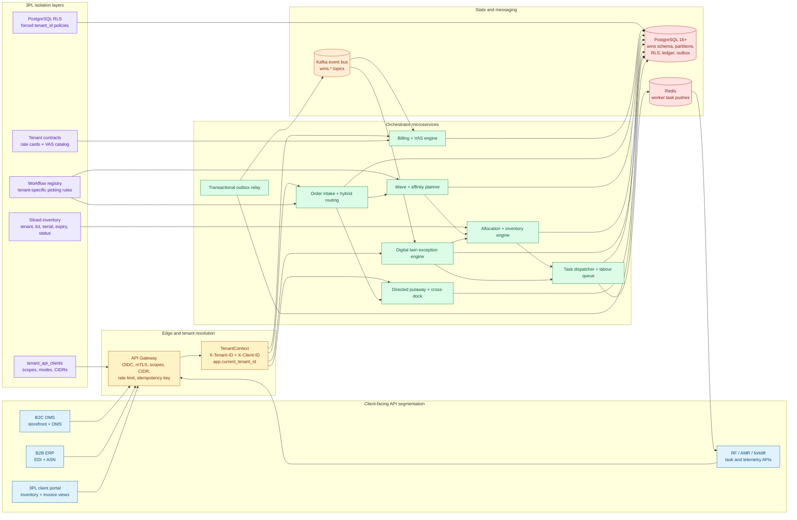
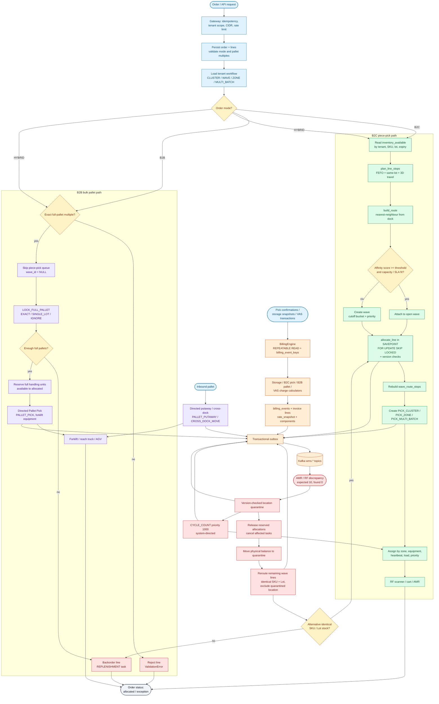

# Visual Architecture Blueprints

Both diagrams are stored as standalone Mermaid.js sources in `diagrams/` and are validated by `tests/diagram_validation/parse.mjs` with Mermaid 12.3.0.

## System Architecture Diagram

## Hybrid Order Fulfillment Workflow

